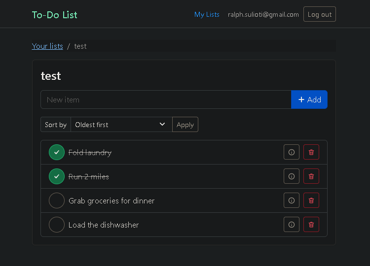
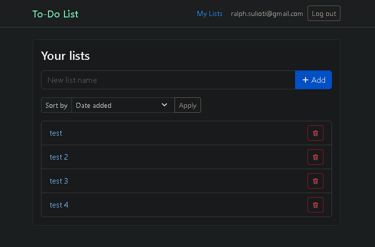
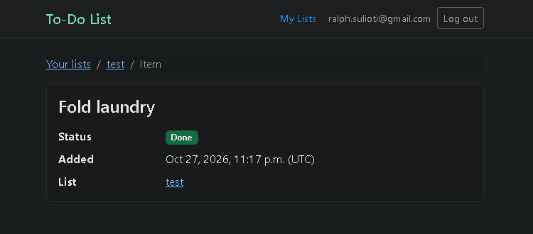
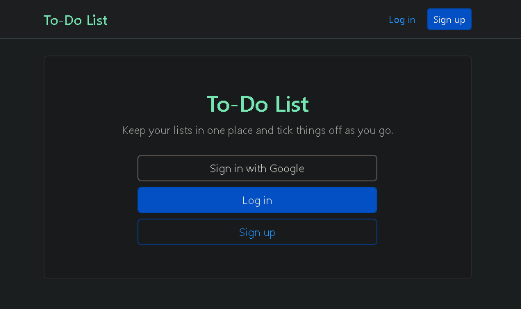

# To-Do List

[](https://github.com/ralphsulioti/To-Do-List/actions/workflows/ci.yml)

A to-do list web app built with Django and Bootstrap 5. Users can:

1. Sign up and log in with a username and password, or with Google
2. Create and delete to-do lists
3. Add items to a list, mark them done or not done, and delete them
4. View an item's details: its status, when it was added, and its list
5. Sort lists by date added or name, and items by date, name or status

Each user sees only their own lists and items. The tests use Django's built-in test framework, and GitHub Actions runs them, with linting, on pull requests and pushes to `main`.

## Screenshots

| A list | Your lists |
|---|---|
|  |  |
| **Item details** | **Home (signed out)** |
|  |  |

## Setup

You need [uv](https://docs.astral.sh/uv/getting-started/installation/). It installs the pinned Python version and the dependencies for you.

1. Clone the repo and install the dependencies:
   ```bash
   git clone https://github.com/ralphsulioti/To-Do-List.git
   cd To-Do-List
   uv sync
   ```
2. Create the database:
   ```bash
   uv run python todo_list_proj/manage.py migrate
   ```
3. Copy `.env.example` to `.env`:
   ```bash
   cp .env.example .env
   ```
   In `.env`, set `DJANGO_DEBUG=1`, and set `DJANGO_SECRET_KEY` to the output of:
   ```bash
   uv run python -c "import secrets; print(secrets.token_urlsafe(50))"
   ```
4. Start the server:
   ```bash
   uv run --env-file .env python todo_list_proj/manage.py runserver
   ```
   Open http://127.0.0.1:8000/ and use **Sign up** to create an account.

## Checks

Run these from the repo root. The tests use Django's test runner and need no `.env`.

```bash
uv run ruff check
uv run ruff format --check
uv run python todo_list_proj/manage.py check
uv run python todo_list_proj/manage.py makemigrations --check --dry-run
uv run python todo_list_proj/manage.py test todo_list
```

## Google sign-in (optional)

Local signup and login work without this. To add the "Sign in with Google" button:

1. In [Google Cloud Console](https://console.cloud.google.com/), open **Google Auth Platform**. If the project has never used it, click **Get started** and fill in the app name and support email. Under **Audience**, choose External, keep it in Testing, and add your Google account as a test user.
2. Under **Clients**, create a **Web application** client with this authorized redirect URI:
   `http://127.0.0.1:8000/accounts/google/login/callback/`
   Open the app at `127.0.0.1`, not `localhost`; Google treats them as different addresses.
3. Copy the client ID and secret into your `.env` straight away; Google shows the full secret only once:
   ```
   GOOGLE_CLIENT_ID=...
   GOOGLE_CLIENT_SECRET=...
   ```
4. Restart the server with `uv run --env-file .env python todo_list_proj/manage.py runserver`. The button shows only when both values are set.
